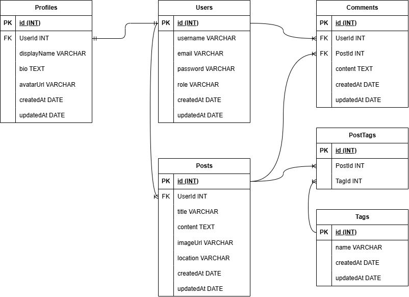

# PROYEKIN

**PROYEKIN** adalah aplikasi media sosial bertema pembangunan yang menjadi tempat bagi komunitas untuk membagikan proyek, progres pekerjaan, serta inspirasi seputar konstruksi, renovasi, arsitektur, interior, dan infrastruktur.

Pengguna dapat menjelajahi posting proyek, mencari proyek berdasarkan judul, melihat profil anggota komunitas, dan membaca komentar. Setelah masuk ke akun, pengguna juga dapat membuat posting, mengunggah gambar, memilih tag, memberikan komentar, mengelola posting miliknya sendiri, serta memperbarui profil.

## Fitur Utama

- Registrasi akun dengan pilihan peran `buyer` atau `seller`.
- Login dan logout menggunakan session.
- Password disimpan dalam bentuk hash menggunakan bcrypt.
- Menampilkan posting terbaru pada halaman utama.
- Pencarian posting berdasarkan judul proyek.
- Membuat, melihat, mengubah, dan menghapus posting.
- Otorisasi agar posting hanya dapat diubah atau dihapus oleh pemiliknya.
- Mengunggah gambar proyek berformat JPG, PNG, atau WEBP dengan ukuran maksimal 5 MB.
- Menambahkan lokasi dan beberapa tag pada posting.
- Menambahkan komentar pada detail posting.
- Melihat profil pengguna beserta seluruh posting miliknya.
- Mengubah display name, bio, dan foto profil.
- Validasi data pada akun, profil, posting, tag, dan komentar.

## Teknologi

- Node.js
- Express.js
- EJS
- PostgreSQL
- Sequelize dan Sequelize CLI
- express-session
- bcryptjs
- Multer
- CSS

## Struktur Database

PROYEKIN menggunakan enam entitas utama:

- `User` memiliki satu `Profile`, banyak `Post`, dan banyak `Comment`.
- `Post` dimiliki oleh satu `User` dan memiliki banyak `Comment`.
- `Post` dan `Tag` memiliki relasi many-to-many melalui `PostTag`.



## Persyaratan

Pastikan perangkat sudah memiliki:

- Node.js dan npm
- PostgreSQL

## Instalasi

1. Clone atau unduh repository ini, lalu masuk ke direktori proyek.

   ```bash
   cd proyekin
   ```

2. Instal seluruh dependency.

   ```bash
   npm install
   ```

3. Sesuaikan koneksi PostgreSQL pada `config/config.json`, khususnya bagian `development`.

   ```json
   {
     "development": {
       "username": "YOUR_POSTGRES_USERNAME",
       "password": "YOUR_POSTGRES_PASSWORD",
       "database": "proyekin-db",
       "host": "127.0.0.1",
       "dialect": "postgres"
     }
   }
   ```

4. Buat database dan jalankan seluruh migration.

   ```bash
   npx sequelize-cli db:create
   npx sequelize-cli db:migrate
   ```

5. Isi database dengan data awal.

   ```bash
   npx sequelize-cli db:seed:all
   ```

6. Jalankan aplikasi.

   ```bash
   npm start
   ```

7. Buka aplikasi melalui browser.

   ```text
   http://localhost:3000
   ```

## Cara Menggunakan

1. Buka halaman **Register** untuk membuat akun baru.
2. Login menggunakan email dan password yang sudah didaftarkan.
3. Pilih **Create Post** untuk membagikan proyek pembangunan.
4. Isi judul, deskripsi, lokasi, tag, dan gambar proyek jika diperlukan.
5. Buka detail posting untuk melihat informasi lengkap dan menambahkan komentar.
6. Gunakan halaman **Profile** untuk melihat posting sendiri atau memperbarui profil.
7. Pemilik posting dapat mengubah atau menghapus posting melalui halaman detail.

## Route Utama

| Method | Route                     | Keterangan                              |
| ------ | ------------------------- | --------------------------------------- |
| `GET`  | `/`                       | Menampilkan dan mencari posting proyek  |
| `GET`  | `/register`               | Menampilkan formulir registrasi         |
| `POST` | `/register`               | Membuat akun dan profil baru            |
| `GET`  | `/login`                  | Menampilkan formulir login              |
| `POST` | `/login`                  | Memproses login                         |
| `POST` | `/logout`                 | Keluar dari akun                        |
| `GET`  | `/users/:id`              | Menampilkan profil pengguna             |
| `GET`  | `/profile/edit`           | Menampilkan formulir edit profil        |
| `POST` | `/profile/edit`           | Memperbarui profil pengguna             |
| `GET`  | `/posts/add`              | Menampilkan formulir posting baru       |
| `POST` | `/posts/add`              | Membuat posting baru                    |
| `GET`  | `/posts/:id`              | Menampilkan detail posting dan komentar |
| `GET`  | `/posts/:id/edit`         | Menampilkan formulir edit posting       |
| `POST` | `/posts/:id/edit`         | Memperbarui posting                     |
| `POST` | `/posts/:id/delete`       | Menghapus posting                       |
| `POST` | `/posts/:id/comments/add` | Menambahkan komentar                    |

## Pengembang

PROYEKIN dikembangkan oleh:

- [rockwellsinaga](https://github.com/rockwellsinaga)
- [MuhammadFardianBilqisthi](https://github.com/MuhammadFardianBilqisthi)
